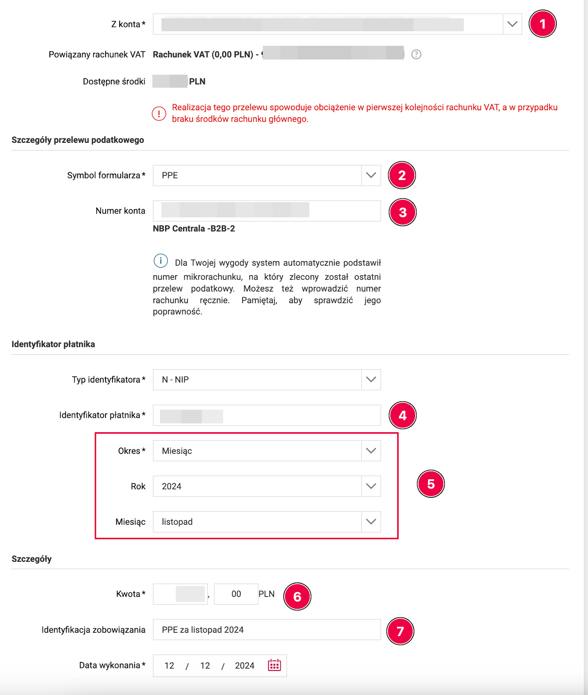

# Routine operations for a sole proprietor (monthly) using infakt.pl

This document describes the typical monthly operations for a sole proprietor on ryczałt using infakt.pl.
The minimum infakt setup is described on the [infakt setup page][1].

Sign up for infakt using [our referral link][2] and get 100zł cashback.

## Issuing invoices

On the last day of the month (if you have a monthly billing agreement with your client), or upon completion (delivery) of work, you need to generate and issue an invoice to the client. To do this, go to the [Przychody][3] section and click the **Nowa faktura** button.

![inFakt: Lista przychodów, кнопка Nowa faktura и вкладка Robocze][4]

You can also do the same from the client list:

**Przychody -> Klienci -> Nowa faktura**

For the selected client, or from the services list:

**Przychody -> Produkty**, check the desired service, and select **Nowa faktura**.

In the new invoice, select/adjust the required fields (if not already filled in):

1. client (from the list)
2. service date (last day of the month or the actual service date if services are irregular)
3. payment method — most likely **Przelew** (bank transfer) and select the account (if you have several). If no account has been added yet, the service will prompt you to add one
4. service
5. quantity of the "service" (if hourly — the number of hours worked; if a fixed rate — leave it as 1, since the net amount already equals the rate)
6. VAT rate (more details on the [VAT page][5])

![inFakt: форма новой фактуры — заказчик, даты, услуга, ставка VAT][6]

Click **Zapisz szkic** to save a draft. You can find it in the income list under **Robocze**.

!!! warning "Important"
    At this stage the invoice is not yet included in the tax base calculation for the selected month (while it remains in `SZKIC` status). For the invoice to count, you need to print it, send it or mark it as paid.

!!! warning "Invoices through KSeF"
    When KSeF is connected, the form has a separate **Wyślij do KSeF** button. If the invoice must be issued through KSeF, send it using this button and check that a KSeF number has been assigned. Saving a draft or downloading a PDF does not replace submission to KSeF.

To download a PDF, open the invoice from the [invoice list][3] and click **Pobierz PDF**. In the dialog, select the language and click **Pobierz**.

![inFakt: окно Pobierz w formacie PDF, выбор языка и кнопка Pobierz][7]

After printing, the invoice is included in tax and ZUS calculations. The new income list shows payment status (**Nie zapłacono** / **Zapłacono**) separately: this does not replace checking that the invoice has been issued and submitted to KSeF.

You can also send the invoice directly to the client's email by choosing **Wyślij e-mailem**.

## Paying taxes

!!! warning "Important"
    Make sure all invoices have been added, issued and included in the calculation (rather than left in **Robocze**), and that all exchange rate differences for the reporting period have been entered and accounted for. For KSeF invoices, check that submission succeeded.

You can find your tax payment account number using the [instructions on the taxes page][8].
Infakt retrieves the account number automatically during setup.

Tax must be paid by the 20th of the month following the reporting month.
In infakt, under [Księgowość -> Przegląd][9], you can see the amount due for the current month based on the issued invoices and recorded exchange rate differences.

There are two payment options:

1. Manually — from your banking app.
2. Via infakt.

To pay through infakt, click **Opłać z inFakt** and select a payment method. Before confirming, check the total and any fee on the payment screen: the terms depend on the payment method and connected services.

![inFakt: налог к оплате, кнопка Opłać z inFakt][10]

Manual payment is done through your banking app.

!!! example "PKO example"
    Execute a Przelew Podatkowy

    1. select the `Pozostałe` section
    2. type `PPE` in the search box
    3. enter your tax account number
    4. enter the period the tax is being paid for
    5. select `NIP` in the Typ identyfikatora list
    6. enter your NIP number

    Select the account you want to pay the tax from.

!!! example "Millenium example (bank website)"
    Go to Płatności -> Podatkowy/Celny

    

    1. select the account you're paying from (PLN)
    2. specify the payment identifier:
        - `PPE` for income tax
        - `VAT-7` for Polish VAT
    3. enter your [tax payment account number][8]
    4. enter your NIP
    5. select Okres — Miesiąc and the corresponding year and month the tax is being paid for
    6. enter the payment amount
    7. optionally add a comment to the payment (optional field), e.g. `PPE za październik 2024`

    At the bottom, click DALEJ and confirm the payment.

It makes sense to pay from the business account, since banks often require account activity as a condition for a free account package. Enter the payment amount from the infakt page and complete the payment.

When done, mark the tax as paid in infakt.

![PKO: Przelew Podatkowy form — Pozostałe, symbol PPE, tax account, Okres, NIP][11]

## Preparing the ZUS DRA declaration and paying contributions

You can find your ZUS micro-account number at [eskladka.pl][12].
ZUS setup in inFakt is described in the [ZUS data settings section][13].

By the 20th of each month you need to pay the ZUS contribution and submit the declaration. As with taxes, the same two payment options are available. Check any fee on the payment screen before confirming.

To pay directly through your banking app, execute a Przelew Krajowy, select the account to pay from (as mentioned above, it makes sense to pay from the business account):

1. enter the recipient
2. enter your ZUS micro-account number
3. the transfer title doesn't matter — you can note the payment period for yourself, e.g. "SKLADKA ZUS 06 2025"

Enter the amount from the infakt page and complete the payment.

![PKO: ZUS contribution transfer — recipient, micro-account number, Tytuł][14]

When done, mark the contribution as paid.

To obtain the ZUS DRA file, go to **Księgowość -> Składki ZUS** and click the relevant month.

![inFakt: Składki ZUS, выбор месяца в колонке Okres][15]

1. For record-keeping, it's worth attaching the ZUS payment receipt to the entry in infakt (`Dodaj załącznik`)
2. Click **Pobierz deklarację ZUS**, then **Pobierz XML**, to download the file for import into ZUS

![inFakt: страница складки, Pobierz deklarację ZUS и область добавления вложения][16]

The downloaded file can be imported on the ZUS portal. Alternatively, you can create the same declaration manually, but importing the file is a bit faster.

To import the file, log in to the ZUS portal, go to the [ePłatnik][17] tab under Dokumenty, and select Import KEDU.

![ZUS portal, ePłatnik: Dokumenty section, Import KEDU item][18]

Review your data, click Dalej. On the next screen don't select anything, click Dalej again until you see the "Wybierz plik..." button. Click it and select the XML declaration file downloaded from infakt.

![ePłatnik, Import KEDU: Wybór dokumentów screen, Dalej button][19]

![ePłatnik, Import KEDU: Wybierz plik button and the loaded XML file][20]

If a ZIPA declaration appears after the import, uncheck it and click Dalej.

![ePłatnik, Import KEDU: unchecking the ZUS ZIPA declaration][21]

Now you can click Podgląd to verify that the declaration contains the figures you expect.
Then click `Weryfikuj`, followed by `Wyślij i zakończ`. Sign the declaration with your profil zaufany and you're done. The document should appear in the `Dokumenty wysłane` folder.

## Receiving payment and accounting for exchange rate differences

!!! info
    When receiving payment in a foreign currency, exchange rate differences may arise. The law requires accounting for exchange rate differences — both positive and negative. An exchange rate difference is not treated as income or an expense; it is an income adjustment and is therefore taken into account when calculating income.

To account for exchange rate differences, you need to know the rate (`K1`) at which the invoice was issued, and the Polish National Bank rate (`K2`) on the last business day preceding the payment receipt date. If the invoice issue date differs from the sale date, use the earlier date for (`K1`). If the currency from the business account is sold later, another rate (`K3`) may arise at the time of the currency sale. It is determined as the actual exchange rate at the time of selling the currency. The actual exchange rate can be determined when exchanging currency for zlotys. If the actual exchange rate `K3` is not known, then — as with receiving payment — it is calculated for the business day preceding the currency exchange date. Transferring foreign currency from the JDG currency account to a personal currency account does not create an exchange rate difference, since withdrawal of these funds is not related to business activity.

🧮 [K2 ≠ K1 Calculator][22] (Transactional exchange rate differences from income) 
`Kalkulator różnic kursowych - przychody w walucie obcej`

🧮 [K3 ≠ K2 Calculator][23] (Exchange rate differences from own funds in a currency account) 
`Kalkulator różnic kursowych od własnych środków walutowych`

🧮 [Calculator][24] (Exchange rate differences from expenses) 
`Kalkulator różnic kursowych - koszty podatkowe w walucie obcej`

* In the field marked with an asterisk, enter the actual exchange rate or leave it blank to use the average NBP rate from the previous business day before the transaction date.

!!! tip "Infakt Premium"
    If you have the Premium subscription plan in Infakt, exchange rate differences will be calculated automatically when you mark the invoice as paid.

If you're on a cheaper subscription plan, you can use the following instructions.

To enter an exchange rate difference (`K2` != `K1`, or `K3` != `K2`), you need to add a `Dowód wewnętrzny`. To do this, go to [Przychody -> Lista przychodów][3], and there:

1. Click **Inne dokumenty** — the three-dot button next to **Nowa faktura**
2. Select `Dowód wewnętrzny`

![inFakt: меню Inne dokumenty, пункт Dowód wewnętrzny][25]

Here you select:

1. `Pozostałe przychody`
2. enter `dodatnia różnica kursowa` or `ujemna różnica kursowa` depending on whether the difference is positive or negative
3. enter the exchange rate difference amount (with a minus sign if it's negative)
4. optionally, you can add details about the rates you calculated

![inFakt: форма Dowód wewnętrzny — Pozostałe przychody, сумма курсовой разницы][26]

Save the changes and the document immediately starts participating in the tax base calculation.

## Submitting the VAT JPK_V7M declaration

An entrepreneur registered on the white list as a czynny VAT payer is required to submit the JPK_VAT declaration for the previous month by the 25th of each month.

Before submitting, make sure you've entered all expenses you want to deduct VAT from in infakt's costs section. Also make sure all your invoices are included in the tax calculation — i.e. you've printed them, marked them as paid, or sent them via email.

Now go to the menu księgowość -> Jednolity Plik Kontrolny and select the month you want to submit the declaration for.

![Jednolity Plik Kontrolny — список деклараций][27]

Make sure the amount in the declaration matches your expectations.

If you have a VAT overpayment and want to get it refunded to your account, select **Zwrot podatku** from the actions menu on the right (available only when there is an overpayment), then choose the appropriate VAT refund option. The deadlines for 2026 according to the [Ministry of Finance][28] are:

- 25 days if you meet certain conditions, including being a czynny VAT payer for at least a year.
- 40 days — the standard deadline for reporting periods from February 2026 onwards (replacing the former 60 days).
- 180 days — if you had no sales with VAT or cross-border sales, but you purchased something for the business.
- Refund to the VAT account (within 25 days). No additional conditions required. Money from the VAT account can only be spent on taxes and ZUS.

![inFakt: Część deklaracyjna, поля возврата VAT и зачёта в будущие налоги][29]

If you don't want to wait months for a VAT refund, you can credit the VAT against another tax — for example, PIT-28 for ryczałt.

1. Go to the **zwrot podatku** menu
2. Enter the overpayment amount in the **Kwota do zaliczenia na przyszłe zobowiązania podatkowe** field.
3. Write in words which tax you want to apply the VAT overpayment to. For example: PIT-28 za kwiecień 2026.
4. Before reducing your income tax payment, check that the tax office has credited the refund against the intended liability.

Legal basis: [Art. 87][30]

Click **Zapisz** in the refund dialog, then check the selected refund and credit details in **Część deklaracyjna**.

Now you can submit the declaration by clicking **Wyślij do urzędu**.

![wyślij do urzędu][31]

Complete the submission authorization. If using authorization data, enter the **income from your PIT for the year before last**, rather than the tax amount.

You'll receive a UPO from the tax office shortly.

## Submitting the VAT-UE declaration

If you're registered in the VAT-UE registry, you are required to submit a VAT-UE declaration for the previous month by the 25th of each month. However, unlike JPK_VAT7, there is no obligation to submit zero VAT-UE declarations if there were no intra-EU transactions in the reporting period.

To submit the VAT-UE declaration, go to księgowość -> [Podatek VAT][32]. Select the desired month, verify that the correct amounts have been pulled into the declaration from your invoices, and submit by clicking **Wyślij do urzędu**.

![Podatek VAT-UE — список деклараций][33]

### "Weryfikacja negatywna" error when submitting

When submitting the declaration, you may receive a rejection:

> Weryfikacja negatywna – błąd w danych autoryzujących (np. błąd w nazwisku, pierwszym imieniu, dacie urodzenia, NIP, numerze PESEL, kwocie przychodu)

To authorize the submission, the tax office checks **the income amount from your PIT declaration for the year before last** (for example, when submitting in 2026 — the income from your PIT for 2024). The amount itself has nothing to do with the contents of the VAT-UE declaration; it is used solely for identity verification.

How to fix it:

1. Find your PIT declaration for the year before last (for ryczałt that's PIT-28) and take the income amount from it (in PIT-28 — field 62).
2. Enter this amount in inFakt: **Ustawienia -> Księgowość -> Podatek dochodowy -> Przychód w roku N** (N being that year).

    ![Ustawienia — Przychód w roku][34]

3. Submit the declaration again.

If you had no income in the year before last (or the business didn't exist yet), the field should contain `0` — in that case the declaration goes out without the income amount confirmation.

## Editing an invoice

Before issuing an invoice in KSeF, you can change its details through **... -> Edytuj**. Drafts are available under **Przychody -> Lista przychodów -> Robocze**. Check and correct the details before submitting with **Wyślij do KSeF**.

Once KSeF has accepted an invoice, you cannot change it. To correct the price, quantity, VAT or buyer details, open the **...** menu on the right and select **Wystaw korektę** to issue a corrective invoice.

![inFakt: меню фактуры, пункты Wystaw korektę и Edytuj][35]

After submission to KSeF, **Edytuj** only lets you change available internal inFakt bookkeeping fields, such as the ryczałt rate. This does not change the invoice in KSeF. For an invoice already sent to KSeF, the buyer, price and VAT fields are disabled. Changing only the ryczałt rate does not require resending the invoice to the client or KSeF — see the [inFakt instructions][36].

Edit the available fields and click **Zapisz** in the bottom right corner.

![inFakt: кнопка Zapisz в форме редактирования фактуры][37]

After saving, check the entry in **Księgowość -> Ewidencja przychodów**. If tax for the period has already been calculated or paid, check its amount after the change as well.

[1]: infakt_settings.md
[2]: https://www.infakt.pl/polecam/sobolevbel
[3]: https://app.infakt.pl/app/faktury
[4]: images/infakt_routine/01_lista_przychodow.jpg
[5]: taxes.md#vat
[6]: images/infakt_routine/02_nowa_faktura.jpg
[7]: images/infakt_routine/03_pobierz_pdf.jpg
[8]: taxes.md#how-to-find-your-tax-payment-account
[9]: https://app.infakt.pl/app/ksiegowosc
[10]: images/infakt_routine/04_ksiegowosc_oplaty.jpg
[11]: images/infakt_routine/podatek_zryczaltowany_pko.png
[12]: https://eskladka.pl/Home
[13]: infakt_settings.md#zus-settings
[14]: images/infakt_routine/zus_pko.png
[15]: images/infakt_routine/05_skladki_zus.jpg
[16]: images/infakt_routine/06_deklaracja_zus.jpg
[17]: https://www.zus.pl/portal/eplMain.npi
[18]: images/infakt_routine/zus_import_kedu.png
[19]: images/infakt_routine/zus_import_kedu_1.png
[20]: images/infakt_routine/zus_import_kedu_2.jpg
[21]: images/infakt_routine/zus_import_kedu_3.jpg
[22]: https://kalkulatory.gofin.pl/kalkulatory/kalkulator-walutowy-roznic-kursowych-przychody-w-walucie-obcej
[23]: https://kalkulatory.gofin.pl/kalkulatory/kalkulator-roznic-kursowych-od-wlasnych-srodkow-walutowych
[24]: https://kalkulatory.gofin.pl/kalkulatory/kalkulator-walutowy-roznic-kursowych-koszty-podatkowe-w-nbsp-walucie-obcej
[25]: images/infakt_routine/07_inne_dokumenty.jpg
[26]: images/infakt_routine/08_dowod_wewnetrzny.jpg
[27]: images/infakt_routine/09_jpk_v7.jpg
[28]: https://podatki.gov.pl/podatki-firmowe/vat/poradniki-i-informatory/odliczenie-i-zwrot-podatku-vat
[29]: images/infakt_routine/10_jpk_zwrot_podatku.jpg
[30]: https://sip.lex.pl/akty-prawne/dzu-dziennik-ustaw/podatek-od-towarow-i-uslug-17086198/art-87
[31]: images/infakt_routine/11_jpk_wysylka.jpg
[32]: https://app.infakt.pl/app/ksiegowosc/podatki/vat
[33]: images/infakt_routine/12_vat_ue.jpg
[34]: images/infakt_routine/13_przychod_autoryzacja.jpg
[35]: images/infakt_routine/14_menu_faktury.jpg
[36]: https://pomoc.infakt.pl/hc/pl/articles/39775503848850-Jak-zmieni%C4%87-stawk%C4%99-rycza%C5%82tu-na-wystawionej-fakturze-bez-sk%C5%82adania-korekty
[37]: images/infakt_routine/15_zapisz_fakture.jpg
